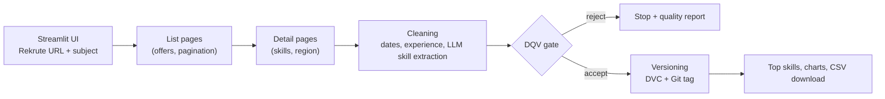

# IT Jobs Skills Pipeline (Rekrute)

> Scrapes IT job offers from [Rekrute](https://www.rekrute.com), cleans them, extracts the technical skills with an LLM, validates data quality, versions the dataset with DVC, and shows the most requested skills in a Streamlit app.

## Goal

Identify which technical skills are most requested in IT job offers in Morocco, for a given search keyword (e.g. `data scientist`, `développeur`, `ingénieur réseau`).

Job offers are hard to analyse as published: skills are written as free text, in several layouts (bullet lists, proficiency levels, narrative paragraphs), and dates, experience levels and missing values are inconsistent. This pipeline turns a Rekrute search URL into a clean, validated, versioned CSV and a skills ranking.

## Pipeline



## 1. Scraping

The scraper lives in `scrapers/rekrute.py` and exposes `scrape(url) -> pandas.DataFrame`.

- **Input**: a Rekrute search URL containing a `keyword=` parameter, e.g. `https://www.rekrute.com/offres.html?keyword=data+scientist`. The keyword is extracted and URL-decoded, so accents work (`ing%C3%A9nieur+r%C3%A9seau`).
- **List pages**: results are read page by page. Scraping stops when a page has no offers or no *new* offers (offers are deduplicated by link).
- **Detail pages** (optional): each offer page is visited to get the required profile text (technical skills), soft skills tags and the region.
- **Politeness**: 2 s between list pages, 1.5 s between detail pages, browser-like `User-Agent`.

| Parameter | Default (app) | Description |
|---|---|---|
| Number of pages | 2 (1 to 10) | Result pages to scrape |
| Scrape details | on | Visit each offer for skills and region. Required for the skills analysis, but much slower |

## 2. Cleaning

Implemented in `pipeline/cleaner.py`.

| Column | Raw example | After cleaning |
|---|---|---|
| `date_publication`, `date_fin` | `13/05/2026` | `2026-05-13` |
| `experience` | `Confirmé (5 à 10 ans)` | `5-10 ans` |
| `nb_postes` | `N/A` | `1` (default when not specified) |
| `salaire` | empty (never published) | `Non communiqué` |
| `competences_techniques` | long free text | `Python, Machine Learning, SQL, ...` |
| all columns | `N/A` markers | real missing values |

`teletravail` and `description` are dropped at the end (mostly empty / low value for the analysis).

### Skill extraction with an LLM

The required-profile text comes in very different shapes, for example:

```
Format 1:  Python | Django | REST API | Machine Learning
Format 2:  Talend Open Studio (niveau 3, maîtrise avancée)
           SAP Business Objects BI 4.2 (niveau 3, maîtrise avancée)
Format 3:  "experience with training, evaluating and deploying ML and DL
            models into production environments..."
```

A fixed keyword dictionary cannot cover tools like Talend or SAP Business Objects, so each text is sent to the **Groq API** (`openai/gpt-oss-120b`, `temperature=0`) with a prompt asking for key technical skills only, as a comma-separated list. Example of the intended transformation (illustrative):

```
Before: "End-to-end ML development, model evaluation, applied ML/DL with
         scikit-learn, PyTorch, advanced SQL and Pandas for preprocessing..."
After:  "Machine Learning, Deep Learning, PyTorch, scikit-learn, SQL, Pandas"
```

## 3. Data quality gate (DQV)

Implemented in `pipeline/validator.py`. If a check fails, the pipeline stops and the report is displayed; nothing is saved.

| Check | Rule |
|---|---|
| No duplicates | No duplicated row |
| Missing values | Less than 15% missing per column (`salaire`, `region`, `description` excluded: naturally sparse) |
| Job title | Every offer has a title (`poste`) |
| Dates | `date_publication` is not after `date_fin` |

## 4. Versioning

Accepted datasets are saved as `data/clean/{subject}_v{N}.0.csv` (e.g. `it_jobs_v1.0.csv`); `N` increments automatically for each subject. Each run then runs `dvc add`, commits the `.dvc` file to Git and creates the tag `{subject}_v{N}.0`.

> **Note:** every successful run creates a Git commit and a tag in the repository you run it from.

## 5. Results in the app

- **Compétences**: top 3 skills with the share of offers mentioning them.
- **Offres d'emploi**: top cities, contract types, experience levels.
- **Données**: the cleaned dataset, with a CSV download button.

Output columns: `keyword`, `poste`, `ville`, `region`, `secteur`, `fonction`, `experience`, `niveau_etude`, `contrat`, `nb_postes`, `competences_techniques`, `competences_soft`, `date_publication`, `date_fin`, `lien`, `salaire`.


## Quick start

```bash
git <url-du dépôt>
cd <repo-name>

python -m venv venv
# Windows:      venv\Scripts\activate
# macOS/Linux:  source venv/bin/activate

pip install -r requirements.txt
```

Create a `.env` file at the project root. A free Groq key is available at [console.groq.com](https://console.groq.com):

```
GROQ_API_KEY=your_key_here
```

Git must have an identity configured (`git config user.name` / `user.email`), since versioning creates commits.

```bash
streamlit run app.py
```

Then paste a Rekrute URL (or click a Rekrute example), enter a subject name such as `it_jobs`, and click **Run pipeline**.

## Project structure

```
├── app.py                  # Streamlit UI and pipeline orchestration
├── scrapers/rekrute.py     # list + detail pages scraping
├── pipeline/
│   ├── cleaner.py          # cleaning + LLM skill extraction
│   ├── validator.py        # DQV checks
│   └── versioning.py       # CSV export + DVC + Git tag
├── data/clean/             # versioned datasets (CSV tracked by DVC)
├── requirements.txt
└── .env                    # API key (not committed)
```

The repository also contains scrapers and cleaning code for other sources (Wikipedia, Worldometer), which are not documented here.

## Limitations and roadmap

- The scraper depends on Rekrute's HTML structure and will need maintenance if it changes.
- Skill extraction relies on an external API (rate limits, availability); the ranking is only as representative as the number of offers collected.
- Salaries are never published on the platform, so no salary analysis is possible.
- Only keyword searches are supported (no filters by city or sector).
- Retry and error handling around the LLM calls
- Persist the raw scraped data before cleaning
- Configure a DVC remote (S3, GCS or DagsHub)
- Automated tests (`pytest`)

## Responsible scraping

Only publicly available offers are collected, with pauses between requests. Check Rekrute's `robots.txt` and terms of use before running large collections, and do not redistribute scraped content.

## Tech stack

Python, pandas, BeautifulSoup, Streamlit, Plotly, DVC, Git, Groq API.

## License

MIT

## Author

**Hillary KEREKOU**: engineering student (Data Science & AI). [LinkedIn](https://www.linkedin.com/in/kerekou-hillary-winny-2a0859207/) · [GitHub](https://github.com/Hillary05)
